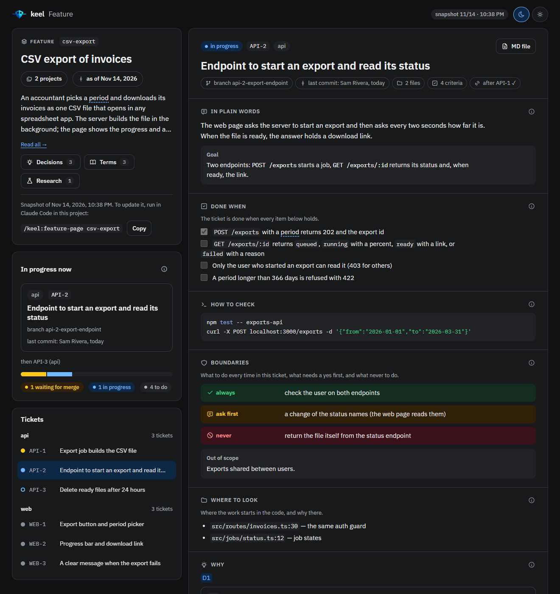
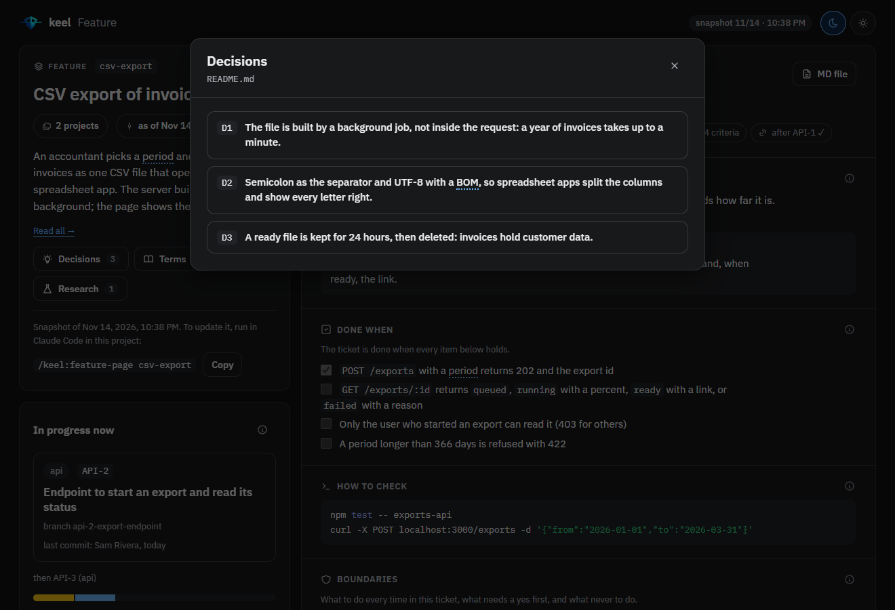
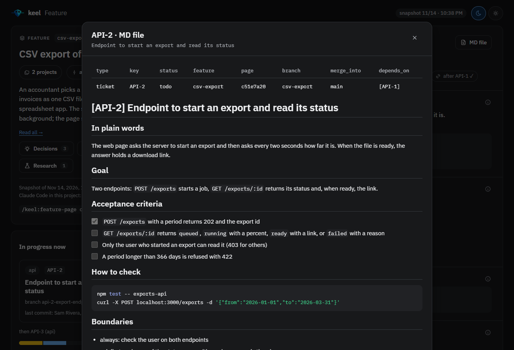
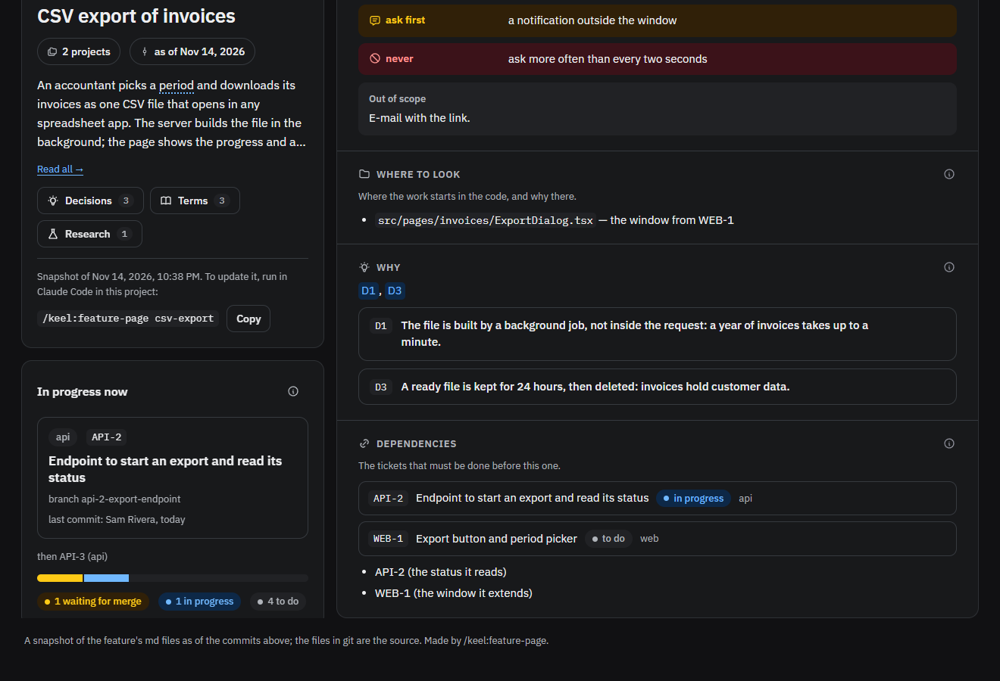
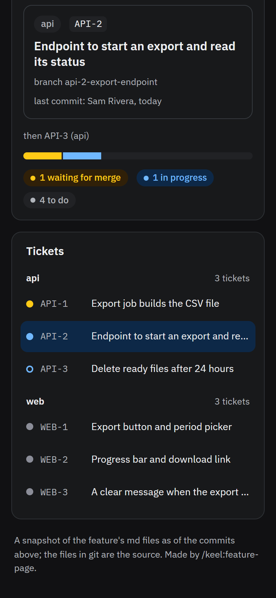
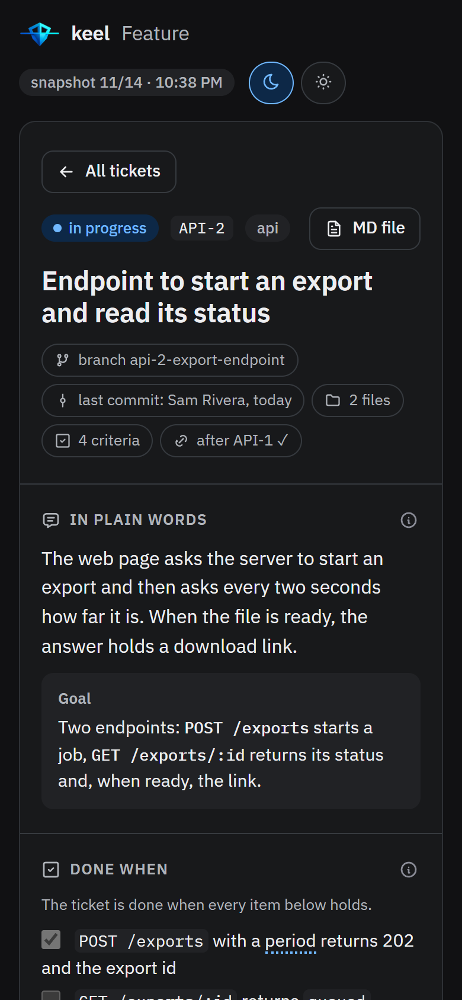
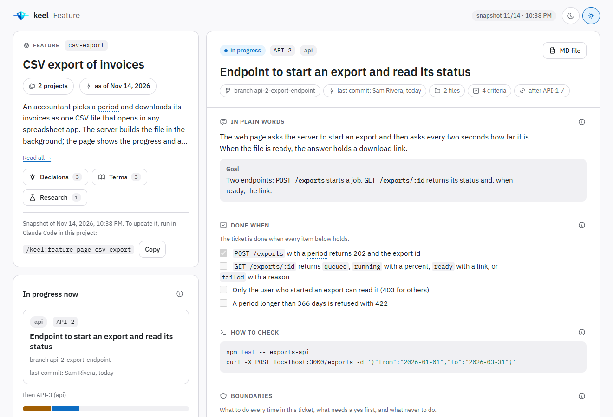

# The feature page

A planned feature lives in md files: an overview and one short ticket per piece of work, maybe in
several repositories. The feature page puts all of it on one private page in your claude.ai account:
what the feature is, what is done, what is in progress, what waits for what, and every ticket in full.
It is for reading and sharing, not for editing: the md files in git stay the source.

You make it, or update it, with `/keel:feature-page <feature>` (every variant:
[Commands](commands.md#keelfeature-page)). How a feature is planned and exported:
[Planning](planning.md). The screenshots below show an invented sample feature, "CSV export of
invoices", with six tickets in two repositories.

## How to use it

1. Plan the feature and export its tickets (`/keel:end-planning final review and export`). A draft
   works too: its tickets show as drafts, with no state from git.
2. Run `/keel:feature-page csv-export` (your feature's name; with none, keel takes the feature of the
   current branch). keel gives the page's link.
3. Open the link. Read the overview and its sections on the left; click a ticket to read it on the
   right; follow its dependencies by clicking them.
4. To share it, use Share on the page. Anyone you share it with sees the page as it was built.
5. After the tickets change (one is started, finished, merged or edited), run the same command again:
   keel finds the same page and updates it. The page never updates itself.

## What is on it

On a computer the page has two columns.

**On the left:**
- **The feature card:** its name, its projects and the commits it is a snapshot of (open on a click),
  the overview in short ("Read all" opens it in full), and buttons for its decisions, terms and
  research, which open in a window in the centre. The card says when the page was built and gives the
  command that updates it, `/keel:feature-page <feature>`, with a Copy button.
- **In progress now** (else what is next), with a bar and the tickets' count by state.
- **The tickets**, grouped by repository, each with its state. The chosen one is highlighted.

**On the right:** the chosen ticket, the one in progress at first. Its header shows its state, key and
repository, its branch and last commit when it has one, the number of files and criteria, and what it
comes after. Its sections are blocks: In plain words with the goal, the trap, Done when, How to check,
Boundaries with Out of scope, Where to look, Why with the decisions it names, and Dependencies with
their states (a click opens that ticket). Each block has an ⓘ whose hint says what it holds. A term
from the overview is underlined with dots where a block first uses it; hover it (tap on a phone) to
read what it means. A link
ending in `#API-122` opens that ticket.

*The Decisions, Terms and Research buttons open a window over the page; Escape or × closes it.*

*"MD file" shows the ticket's file as GitHub draws it, front matter and diagrams included.*

*The end of a ticket: Why shows the decisions it names, Dependencies the tickets it waits for, each
with its own state.*

**Dependencies.** A dependency shows its ticket's own state and, when it holds the ticket back or was
merged in by hand, where its code is: "ready in the <branch> feature branch, not in main" (on hover:
wait for that merge, or pull it into your branch with `git merge`), "ready in the <branch> ticket
branch", or "already in your branch".

**On a phone** the list comes first and a ticket opens as its own screen, with a way back ("All
tickets").

  
  

**Light theme.** The page opens dark; the switch in the header turns on the light theme, and the
choice is remembered in that browser ([the design system](design-system.md)).

## Where the states come from

The page shows git as it was when it was built or updated: it does not update itself. keel runs
`git fetch` first, so the states are fresh; when the fetch fails (no network, no access, or no answer
within 60 s), the page is still made, keel says so, and the feature card marks the states as of the
last fetch. Other repositories of the feature are read as they are on this machine, without a fetch.

A feature on several repositories also shows the other repositories' tickets: read in their folders on
this machine, else from the overview with the state unknown and a "not on this machine" mark; a
dependency on such a ticket is unknown too. A ticket of this repository whose file is only on another
branch is read from that branch and marked "only on branch <branch>".

## How it is built

The texts are those of the md files, which stay the source; keel puts them into a fixed template and
the page draws the markdown and code itself (libraries from cdnjs), so every feature looks the same.
keel publishes it with the `Artifact` tool. Your conversation only finds the page and asks you what it
must (which feature, which of several pages); building, translating and publishing run in one Sonnet
agent, so the page does not stay in the conversation. A new page of 6 tickets translated in full cost
about $0.45 in the agent and $0.15-0.30 in the conversation (measured; more in a longer conversation).

**Language.** `--lang`, else the language the page already has, else your conversation language.
The labels come from keel's language files (English and Ukrainian today; English for another
language). When the page's language is not the tickets', Claude translates the texts on the page only,
never the md files; the page keeps each translation with a fingerprint of its original, so the next
update translates only what changed. Translating costs tokens; the same language costs nothing extra.

**Title and finding the page again.** The page is titled `[API, WEB] - <the overview's heading>
(3f9a2c1b)`: the ticket prefixes of the repositories with tickets, the heading (cut to 80 characters)
and the feature's code. The code is random, made once with the draft (`page:` in `plan.md`) and
written by the export into every ticket of the feature, so it travels with the feature in git: every
machine and every repository of the feature finds the same page, whether or not the other
repositories are on that machine or have a remote, and two projects with the same prefix and feature
name never share a page. keel looks the page up among your latest 200 by the code at the end of its
title and updates it, renaming it when the heading or the repositories changed. A feature exported
before the code gets one, written into its tickets in this working tree: commit and push them. Not
found while you have more → keel asks for its link or makes a new one.

**What stays private.** A path of this machine in the feature's files (a ticket, the overview, a
report) is never published: keel names each one and stops; write it from the repository's root.
Nothing is kept on this machine: the page is built in `.keel/local/tmp/` and removed after publishing.
It needs Claude Code signed in to a claude.ai account; with an API key there is no page. The run's own
cost is the last line of its report.

## Related

[Commands](commands.md#keelfeature-page), [Planning](planning.md), [the design system](design-system.md).
