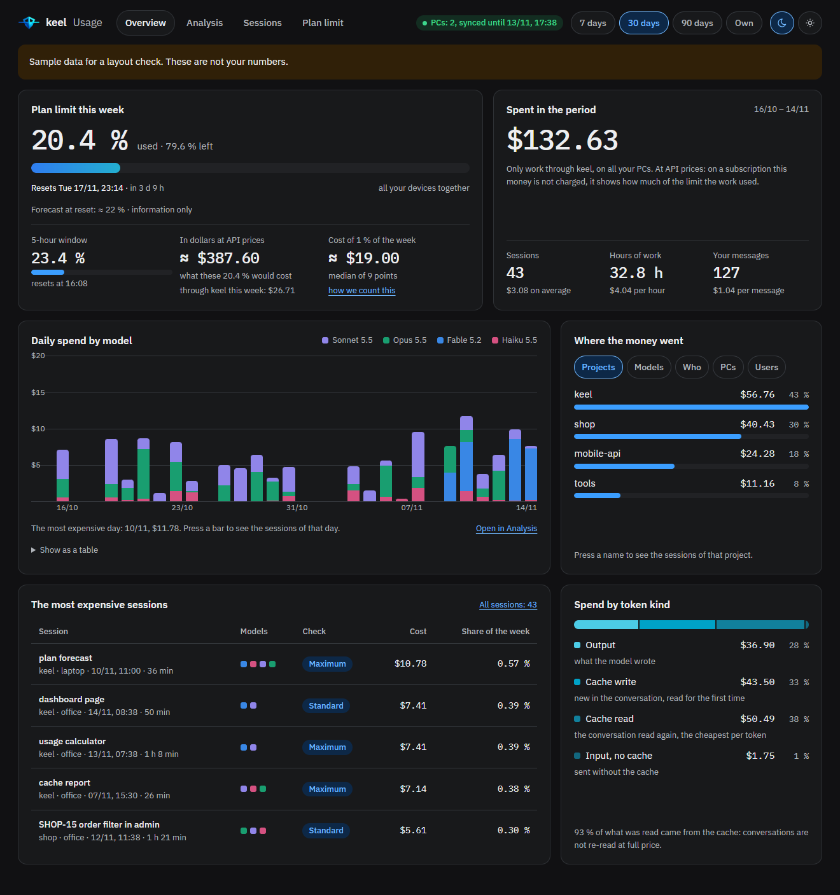
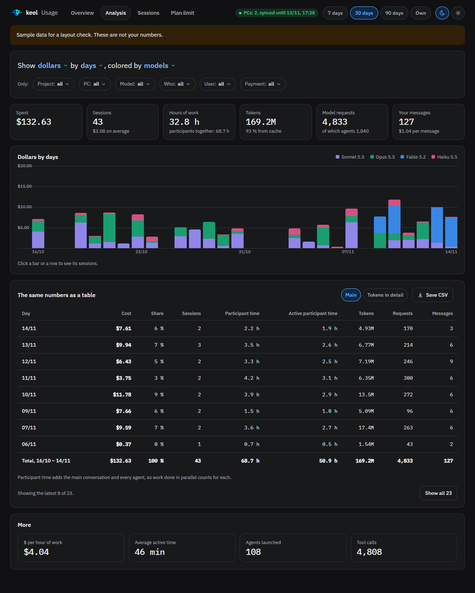
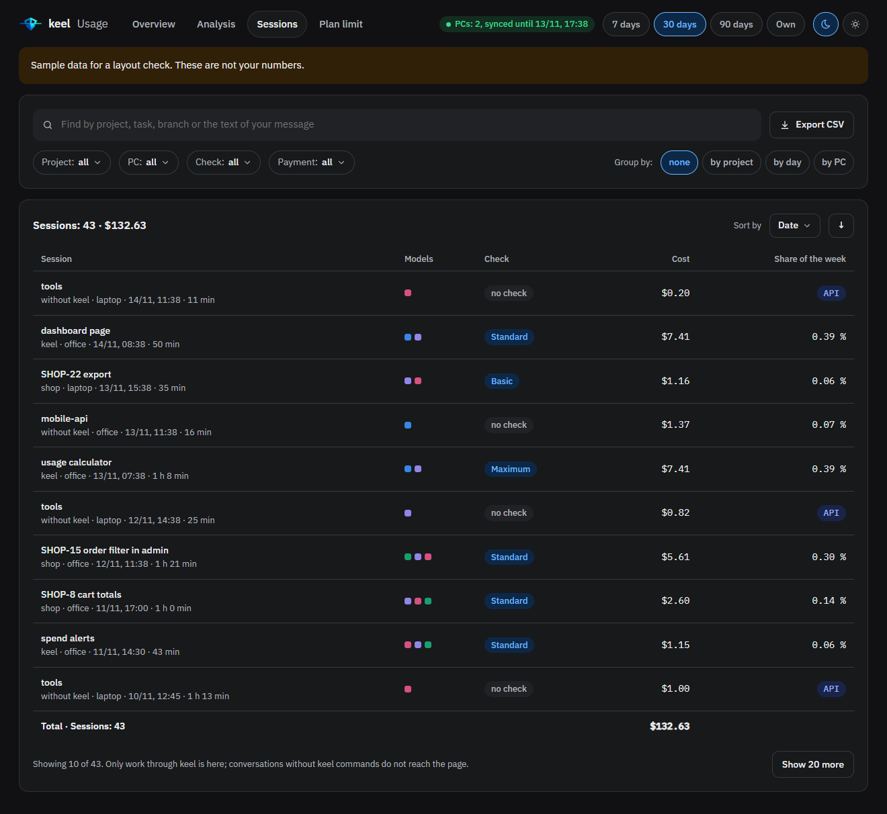
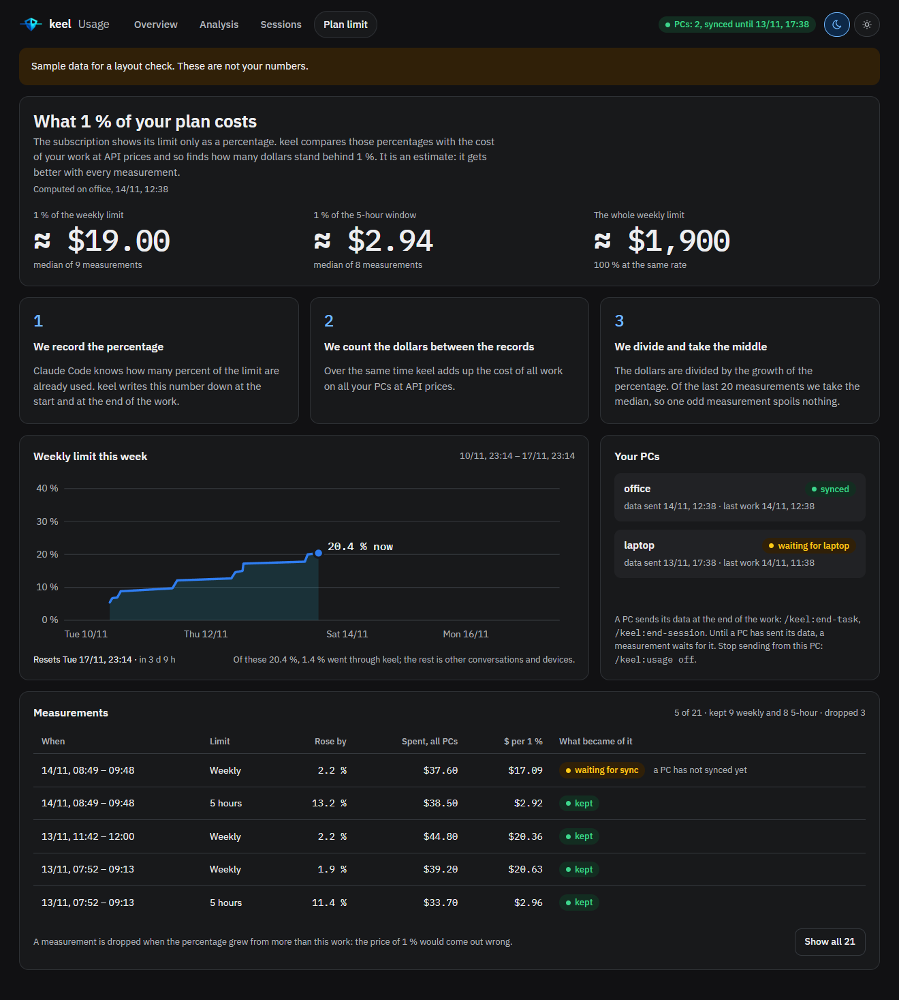

# Cost report and the "keel usage" page

keel shows what a session cost at the end of every `/keel:end-task`, `/keel:end-session` and
`/keel:end-planning`. It can also collect the numbers of all your machines into one private page, "keel
usage", in your own claude.ai account. On a subscription it estimates how many percent of your plan limits a
session used. Everything is read from Claude Code's own local logs, so collecting the numbers costs nothing;
only writing them to the page costs a little (see [syncing](#syncing-between-machines)). This page explains
the report, the page, where the data comes from, what leaves your machine and what never does. On this page
a *session* is one Claude Code conversation, as the page calls it, not keel's long-work lane.

## The cost report

The cost report is the last block of the final report at the end of a task or a session (the whole
report: [ways of working](workflows.md#the-final-report)). It is a table of every participant that
actually ran: the main conversation and each agent run, with its model, requests, tokens by kind (input,
cache write, cache read, output) and dollars at list price with the share of the total, then a total
row. Below that: total time and active time, the number of your turns, and the three most expensive
turns, each with its dollars, requests and agents.

Example (shortened; the numbers are made up):

usage report: session 3f9a1c2e (shop, cli), wallet subscription

| who | requests | in | cache write | cache read | out | $ |
|---|---|---|---|---|---|---|
| main (claude-sonnet-5-5) | 212 | 40 | 310k | 5.20M | 61k | $1.91 (61 %) |
| agent keel:reviewer (claude-sonnet-5-5) | 9 | 14 | 60k | 300k | 7k | $0.25 (8 %) |
| agent keel:bug-hunter (claude-sonnet-5-5) | 14 | 22 | 90k | 610k | 12k | $0.41 (13 %) |
| agent keel:qa (claude-sonnet-5-5) | 25 | 30 | 120k | 900k | 15k | $0.54 (17 %) |
| **total** | 260 | 106 | 580k | 7.01M | 95k | **$3.10** |

```
time: 1 h 05 min, active 38 min
user turns: 6
top turns by cost:
1. $0.84 (40 requests, 3 agents) "/keel:end-task finish"
subscription: dollars are list prices, they count against the plan limits
week: about 0.2 % of the weekly limit (1 % = about $17.40, 4 points)
5-hour: about 1.1 % of the 5-hour limit (1 % = about $2.90, 2 points)
```

Other lines can appear: output estimated from visible text (hidden reasoning is not counted); on a
subscription, how the account's limits moved during the session (`account week limit during the session:
12 → 14 %`, and the same for the 5-hour limit) and which machines the calibration waits for
(`calibration waits for the sync of: ...`); a model without a price (run `/keel:configure prices`); and a
cross-check against Claude Code's own total when the two differ by more than 10 %.

## Wallets

keel's hook marks how each session pays when it starts: `api` when an API key or token
(`ANTHROPIC_API_KEY`, `ANTHROPIC_AUTH_TOKEN`), Bedrock, Vertex, Foundry or Mantle, or an `apiKeyHelper`
is in use; `cloud_wallet` for Claude Code on the web; otherwise `subscription`. A session keel did not
mark gets the machine's `wallet_default`, or `unknown` on a machine marked "both".

| Wallet | When | What the report shows |
|---|---|---|
| subscription | Pro, Max or Team | list-price dollars, and about how many percent of the weekly and 5-hour limits |
| api | an API key or token, an API-key helper, or Bedrock, Vertex, Foundry or Mantle | real money at API prices, no percentages |
| credit | Claude Code on the web (default for it), or a separate prepaid credit | real money, no percentages |
| unknown | a session started without keel's hook, on a machine marked "both" | no percentages; left out of the calibration |

Set the machine's defaults in `/keel:configure usage`: `wallet_default` (for sessions keel did not
mark), `cloud_wallet` (how Claude Code on the web pays) and `also_api` (the machine uses both a
subscription and an API key). See [settings](settings.md#this-machine).

## Plan-limit percentages and calibration

Claude Code gives the plan-limit percentages only to the status line. keel's status line (or yours,
wrapped so it prints exactly as before) records them each time they change. The desktop app has no status
line, so there keel asks the app for the percentages at the end of a task. The status line is installed
by `/keel:configure`.

keel learns the price of one percent from your own usage:

1. A **point** is the window between two recordings in one reset period, with the subscription
   dollars spent in it divided by the percent gained. The dollars are this machine's requests in the
   window plus the hourly totals of the other machines that count (step 5), each hour taken in the part
   that falls inside the window. Sessions that pay with an API key, credit or an unknown wallet do not
   count. A weekly point needs a gain of at least 1 percentage point, a 5-hour point at least 5.
2. The **rate** is the median of the points kept among the last 20 usable ones (step 3).
3. Points are **set aside** when they cannot be trusted: no spend in the window; a rate more than 30 %
   below the median (spend that keel could not see, for example chat on a phone: shown as "another device
   used the plan" on the page and "other device (spend not seen here)" in keel's text output); older than the last 20; or a machine has not synced yet ("waiting for sync").
4. A machine not seen for more than 14 days is no longer waited for, so it cannot block the calibration
   forever.
5. Limits belong to one account, so keel counts only the machines of the same user: those with the
   same git email as this machine, and machines with no git email. When this machine has no git email
   itself, every machine counts.

Until there are measurements, the report says "no calibration yet" and shows no invented number. The
session's share is its dollars divided by the rate.

## The "keel usage" page

`/keel:configure usage` can create the page (it asks first, and only for an account that has one: see
[which accounts get what](#which-accounts-get-what)), and later [update it](#updating-the-page) to a
newer keel's page. It is private: only you see it, unless you share it. `/keel:usage` gives its link and opens it. Its tabs follow. The screenshots show sample data, not real numbers.

The page has the look of every keel page ([the design system](design-system.md)). It opens dark; a switch
in the header turns on the light theme, and the choice is remembered in that browser for that page. The
charts are drawn by the page itself, so no chart library is loaded. The tabs are Overview, Analysis,
Sessions and Plan limit; the links of the earlier names, `#dash` and `#calib`, open Overview and Plan
limit. One period control in the header (7, 30 or 90 days, or your own range) serves Overview,
Analysis and Sessions.

### Overview



*Sample data.* The plan limit of the week: the percent used, when it resets, the forecast at reset
(information only), the 5-hour window, what those percents would cost at API prices, and what 1 %
costs in dollars. Then what was spent in the
period (sessions, hours of work, your messages), daily columns split by model, where the money went
(by project, model, who (main conversation or agents), machine or user), the most expensive sessions and
the spend by token kind (the tokens by kind for a period whose sessions were all sent before keel kept the
dollars by kind; when only some were, a line under the card says how many of the period's dollars it
leaves out). If no session in the period pays from a subscription (all pay with an API key or
credit, or their wallet is unknown), the page says there is no plan limit for that wallet: real money,
no percents. Dollars and
charts count keel sessions only; the limit percentages are those of your whole account, as Claude Code
counts them.

### Analysis



*Sample data.* The controls read as one sentence: show a measure (dollars, tokens, all or by kind,
hours of work, requests, your messages or sessions) by a grouping (day, week, project, PC, user,
participant, model or hour of day), colored by a split. Filters (project, PC, model, participant, user,
payment, which is the [wallet](#wallets)) are chips; the date range is the period control. Under them are six tiles (spent, sessions, hours of work, tokens with
the cache share, model requests, your messages) and, at the bottom, a "More" card (dollars per hour of
work, average active time of a session, agents launched and tool calls). The
chart is followed by the same numbers as a table with two sets of columns, and "Save CSV" saves it. A
click on a column or a row opens its sessions.

On the Overview and Analysis tabs a participant that used several models (for example after a
`/model` switch) counts once per model, with that model's dollars, tokens and requests, so spend by
model stays right.

### Sessions



*Sample data.* Every keel session: date, PC, project, task, models, dollars, percent of the week and the
verification level. Search by project, task, prompt text or branch; filter (as chips) by project, PC,
verification level and payment; group by project, PC or day; sort; save all rows as CSV. The list shows
10 rows, and "Show more" adds 20.

### A session page

Click a session to open it. It shows the cost, duration and active time, the share of the week and of the
5-hour limit, turns and requests, and tokens with the cache share. Below: a timeline of the participants,
a table per participant (model, requests, tokens, active time, dollars, share), the cost of each of your
messages (with the start of the text when previews are on), the tools used, the keel verification (level,
findings must/should/nice, gates, lines, files, plan steps) and the cache.

Each of your messages opens to show what was done after it: the tools with counts, the agents it
started and the part of its dollars they spent, its tokens by kind and the largest context one request
read. A session whose data has no such details (sent before keel kept them, or shortened to fit on the
page) says so in one line.

### Plan limit



*Sample data.* What 1 % of the plan costs in dollars (the weekly limit, the 5-hour limit, and the
whole week at the same rate), how that is counted in three steps, this week's limit as a line, the
machines with their last sync, when each was last seen and whether the measurements wait for them, and
the measurements themselves: every point with its window, gain, dollars, rate and status (kept,
dropped or waiting for sync, with the reason). The latest 5 are shown; "show all" lists the rest.

An empty page says that data arrives after the first `/keel:end-task`, `/keel:end-session` or
`/keel:end-planning` on any machine. Adding `?demo=1` to the page address shows sample data for a layout
check, but only when the page is opened without its data connection (outside claude.ai).

## Where the data comes from

keel reads Claude Code's local logs (the transcripts under `~/.claude/projects`). Nothing is measured by
the model. On each machine keel keeps its own files in `~/.claude/keel/`: session wallets, limit
snapshots, a summary cache, sync state and settings.

## What goes to the page, and what never does

Per machine, the page receives the following. The hourly totals count every Claude Code session
on the machine, in all its projects, because the plan limits count them all and the calibration needs
them; they hold no session id, project or request text. Everything per session goes only for keel
sessions: a session in which you ran `/keel:start-task`, `/keel:end-task`, `/keel:start-session`,
`/keel:end-session`, `/keel:start-planning` or `/keel:end-planning`; a session that ran
`/keel:end-planning` shows "planning: <feature name>" in the Task column (when previews are on). A
conversation without keel shows up only in the hourly totals.

- the machine name, your git email (to tell machines and people apart) and the machine's
  `wallet_default`;
- per hour: dollars, requests and tokens by model and wallet;
- the plan-limit percentages with their reset times (and the spend limit when Claude Code gives one),
  and Claude Code's own cost of the session that recorded them;
- per session: its id, the project folder's name (never the full path), the git branch, the wallet,
  the entry point (for example cli), start and end time, active minutes, dollars and Claude Code's own
  cost; per participant (the main conversation or an agent, with the agent's type) its models,
  requests, tokens, dollars (for each model also split by token kind), active minutes, and tool names
  and counts; per turn of yours its time,
  dollars, requests and agents, and what was done after it (never its text): the tool names with counts
  (the six most used, the rest summed under `other`), the types of the agents it started with counts (the
  four most used, the rest under `other`), the part of its dollars the agents spent, its tokens by kind
  (as for a participant) and the largest context one request read; keel's task data (level, findings,
  gates, lines and files changed, the model of each plan step);
- the first 100 characters of each of your requests, and the task and step titles. In the requests keel
  masks what looks like a secret: JSON web tokens, API keys and tokens in well-known formats (`sk-...`,
  GitHub, GitLab, npm, Stripe, Google, AWS access key ids, Slack), `Bearer` tokens, the user and password
  in a URL, the value after `password`, `token`, `secret` or `api_key`, and long hex or base64 strings.
  The masking works by patterns and is best effort: a secret in another form can get through. Task and
  step titles are sent as written.

Nothing else leaves the machine: not the full project path, and not your code, replies or file
contents. The page is visible only to you unless you share it; a shared page is visible to everyone it is
shared with.

**Turn the previews off** if your requests are sensitive: set `prompt_preview` to false in
`/keel:configure usage` (for every project on the machine), or for one project in
`.keel/local/options.json` (see [settings](settings.md#examples)). Then no request text and no task
title are sent, and step titles are replaced by "step 1", "step 2". Everything else above is still sent.
A project can only turn previews off: when the machine's value is off, a project's `true` has no effect.

## Which accounts get what

| Your account | End report | Usage page | Plan-limit shares |
|---|---|---|---|
| API key only | exact dollars | none: the page lives in a claude.ai account, so there is no usage page and configure asks no page questions | none |
| subscription only | dollars and the share of the weekly and 5-hour limits | yes; the limit calibration uses every machine | yes |
| both | all of that | yes; sessions paid with the API key reach the page with the next claude.ai session | only subscription sessions count in the calibration |

## Syncing between machines

Each end step (`/keel:end-task`, `/keel:end-session`, `/keel:end-planning`) builds this machine's days from
Claude Code's logs, compares them with what it sent before (`sync-state.json`) and writes only the day
documents that changed to the page's database, through files, never through the conversation. One
document holds one day of one machine (`<date>_<pc>`); a large day is split into parts. The first sync
reaches back 30 days (`history_days`). Then keel reads the other machines' data back to calibrate the
limits, and the page's settings to know whether it runs this keel's page
([updating the page](#updating-the-page)).

The sync runs in a small sync agent on Haiku, which the end step starts. Every request of a model
re-reads its whole conversation, so the five or so requests of a sync done in the session itself would
re-read a long session five times. The sync agent's conversation is short, and the session pays only
for two requests: starting the sync agent and reading its one-line answer.

**What it costs** per end of work, at list prices with an Opus session:

| | cost |
|---|---|
| the sync agent (Haiku, about 8 requests) | $0.015-0.017 (measured on 2 runs) |
| the session's 2 requests | $0.04-0.06 each at 140-185k tokens of conversation (measured); they grow with the length of the conversation |
| **in all** | **$0.10-0.14 at 140-185k tokens (measured)**; computed from the same prices: about $0.07 after a short session (100k tokens), about $0.20 after a very long one (450k) |

Done in the session itself it cost $0.15-0.55, typically $0.35 (measured on 58 syncs). On a subscription the
same tokens count against your plan limits instead of money. With a Sonnet session the session's
requests cost about half (computed from the price table, not measured).

- **No sync agent.** A session without the `Agent` tool, or one whose agent cannot start or has no page
  tool, does the sync itself; that costs $0.15-0.55, as said above.
- **Days already on the page stay.** A sync never deletes: when Claude Code removes old logs (after 30
  days by default), the days built from them stay on the page as they were. Only a
  [clear](#clearing-the-page) deletes them. A machine that does not sync for longer than its logs are kept
  loses the days whose logs are gone.
- **Two machines syncing at the same time** do not overwrite each other: each writes only its own days, and
  a document changed meanwhile is refused and written again once.
- **Machine names must differ.** The document id holds the machine name, so two machines with the same
  name write over each other's days. Give each machine its own name in `/keel:configure usage`.
- **A session without the page tool** (for example one with an API key only) cannot write to the page: the
  sync waits, the report says so in one line, and the next session that can sends what the logs still hold.

### Turning the sync on and off

`/keel:usage off` stops this machine's sync: the page and its data stay, and the end reports still show
the costs. `/keel:usage on` sends what Claude Code's logs still hold of the time it was off (they keep 30 days by
default, so a longer break leaves a gap on the page), or sets the page up if there is none.
The same from a shell: `node usage-setup.js <project> sync on|off`; `show` prints `sync: on` or
`sync: off since <date>`. The settings are in `~/.claude/keel/usage.json` ([settings](settings.md#this-machine)).

### One page per account

There is no shared project page: `usage.artifact_url` in `.keel/config.json` is no longer used. Each
machine syncs to its owner's own page, and its owner can show it to others with Share on the page. The key
is still accepted in the config but ignored, and keel says so once per machine.

## Updating the page

A page is a copy of keel's page files made when it was created, so a newer keel's page does not reach it
by itself. When this machine's page was made by an older keel, `/keel:usage` says so and
`/keel:configure usage` offers the update. After your yes keel reads the page (the Artifact tool publishes
over a page only after a read; about $0.1-0.3, an estimate) and publishes keel's current page files, with
the design files (`keel.css`, `keel-theme.js`, `keel-mark.png`), to the same address. The data stays: every machine's days, the calibration and the page's language live in the
page's database, not in its files. keel stops and changes nothing when the page is not titled "keel usage"
or you cannot edit it.

keel cannot see which keel version made the page, so an update from a machine with an older keel puts an
older page back over a newer one; keel says so before you answer. Update keel on every machine that syncs
to the page.

The page itself says which keel page it runs: creating or updating it writes a fingerprint of the page
files into the page's settings (next to its language). Each end step reads it back and keeps this machine's
copy (`page_template`), so after an update from one machine every other machine stops offering it at its
next end step. A page made before keel wrote the fingerprint has none and is offered the update.

## Clearing the page

`/keel:usage clear` clears **only the machine it runs on** and keeps the page. Other machines' data on the
page stays as it is. To clear the whole page, run `/keel:usage clear` on every machine. It reads the
page's documents into `.keel/local/usage/clear` (their contents never enter the conversation) and shows
what would go: this machine's days, from the first to the last, with the number of sessions and their
dollars, all usage in that period, the calibration data, the size in KB, and the number of delete calls in
the chat (each needs your approval; the end report shows the real cost).

And what it affects: this machine's data on the page starts over from the next `/keel:end-task`,
`/keel:end-session` or `/keel:end-planning`; everyone the page is shared with sees the change; it cannot be
undone, because keel keeps no copy of the page. You answer "Delete this PC's data on the page?"; "No, keep
it" is the first option, and only an explicit yes deletes.

What goes: this machine's day documents, `machines/<pc>` and `calib/<pc>`. After the clear this machine
sends only what happens from the clear on, rebuilt from the Claude Code logs from that moment. Its logs,
limit records and calibration stay, so the cost report and the limit percentages keep working, and so do
the page's language setting and the page itself (it hides nothing by date). To remove the page itself, ask
Claude to delete it and run `/keel:configure usage` for a new one.

## Checking the page against the logs

`node <keel>/scripts/usage.js audit --page <folder>` (`<keel>` is the plugin folder; in this repository
`plugins/keel`) compares this machine's dollars and tokens per session on the page with the local
transcripts. `<folder>` is a folder under the project's `.keel/local/` with the database documents saved from
the page; any other folder is refused. The expected number of differences is zero. The audit also names the difference between keel's dollars
and Claude Code's own cost.
One exception: a session too big for one page document is shortened on the page (its cheapest agents
are left out), so its line shows the page's lower dollars against all of the session's and says
"shortened on the page". Such a session gives up the per-turn details first, then the texts, then the
turns, then agents. A session that lost only its turn details or texts keeps all its agents and
dollars, so a difference there has another cause and gets no such mark. The audit compares only dollars
and tokens, so a day sent before the per-turn details existed is not reported for lacking them; it gets
them when one of its sessions changes and the day is sent again.

## Prices

Dollars are list prices from a table that ships with keel. Run `/keel:configure prices` to refresh it:
an agent reads the official pricing page (about $0.1-0.3, an estimate), keel shows the differences and writes the
table to this machine only after your yes (the previous one is kept as a backup).

## Related

[Cost optimization](cost-optimization.md), [settings](settings.md), [verification](verification.md).
