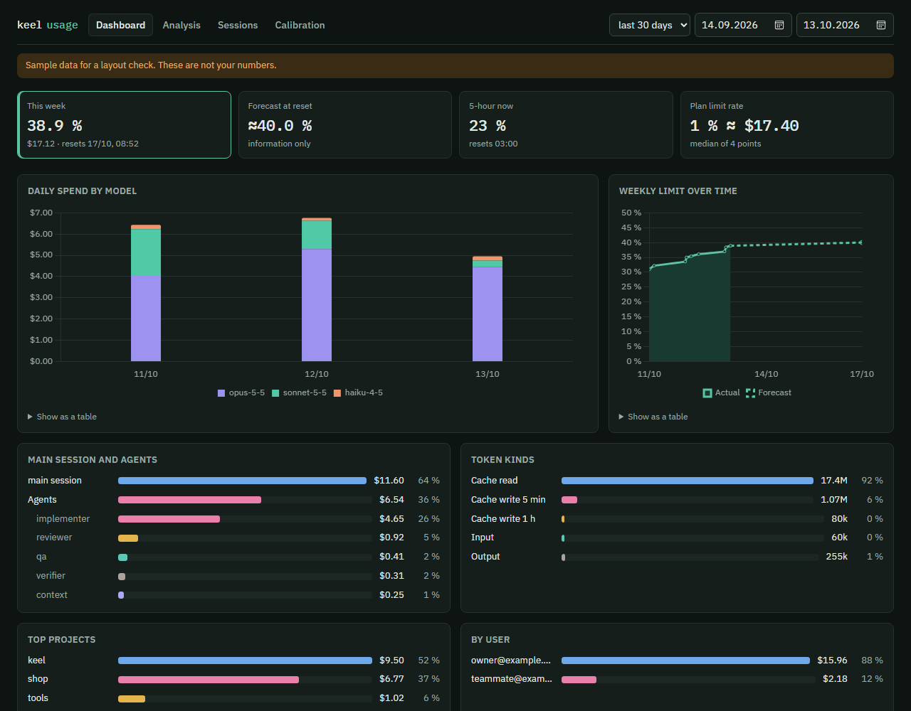
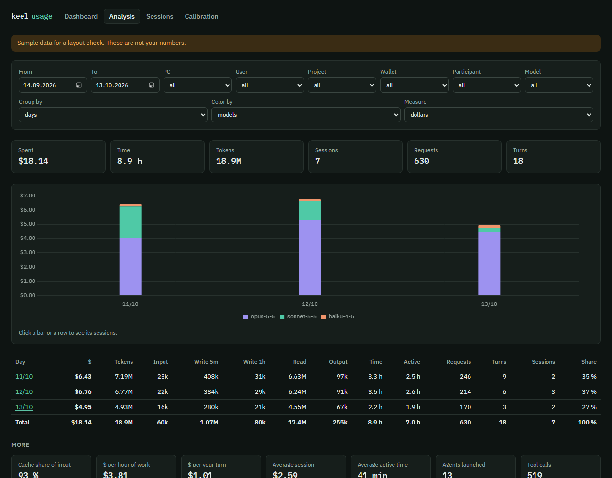
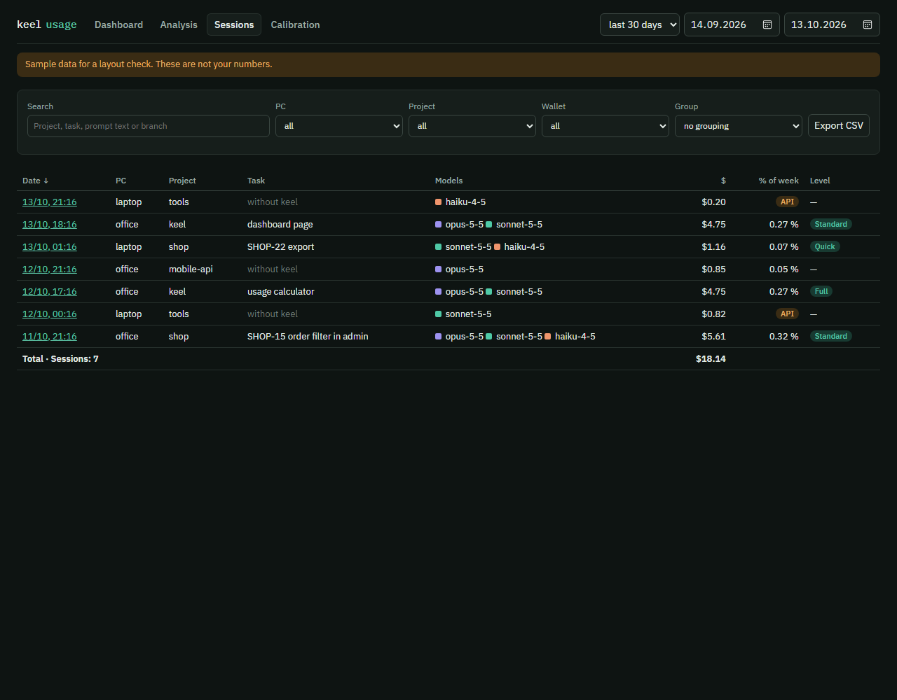
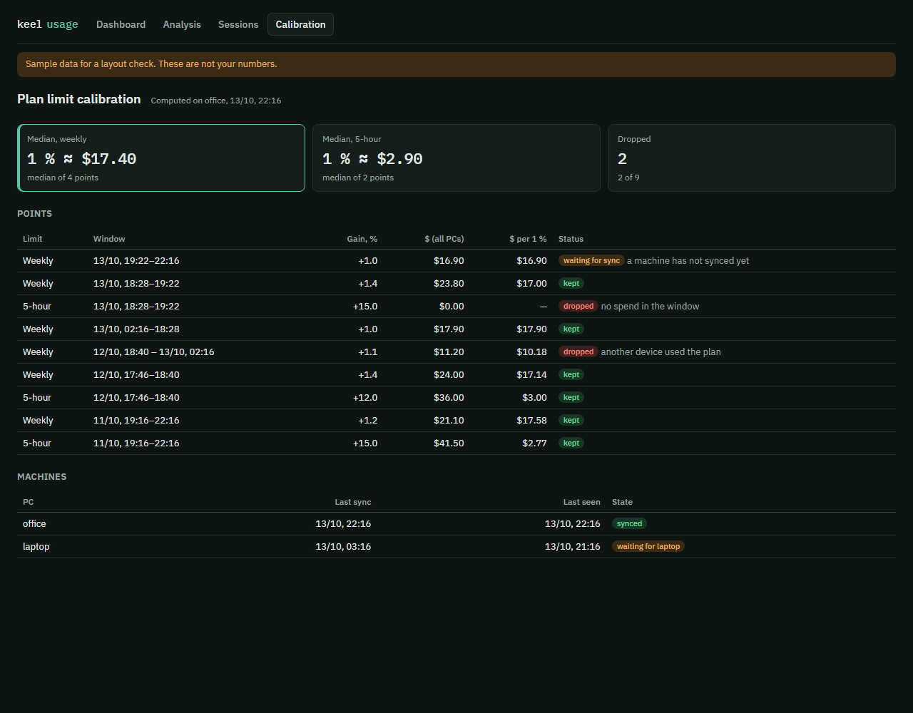

# Звіт про витрати і сторінка «keel usage»

[English](usage-dashboard.md)

keel показує, скільки коштувала сесія, наприкінці кожного `/keel:end-task`, `/keel:end-session` і
`/keel:end-planning`. Він також може зібрати числа з усіх ваших ПК на одну приватну сторінку «keel usage» у
вашому власному акаунті claude.ai. На підписці він оцінює, скільки відсотків лімітів вашого плану
використала сесія. Усе читається з власних локальних журналів Claude Code, тож збирання чисел нічого не
коштує; трохи коштує лише їх запис на сторінку (дивіться [синхронізацію](#синхронізація-між-пк)). Ця
сторінка пояснює звіт, сторінку, звідки беруться дані, що йде з вашого ПК і що не йде ніколи. На цій
сторінці *сесія* — це одна розмова Claude Code, як її називає панель, а не напрямок довгої роботи keel.

## Звіт про витрати

Звіт про витрати — останній блок підсумкового звіту наприкінці задачі чи сесії (увесь звіт:
[способи працювати](workflows.uk.md#підсумковий-звіт)). Це таблиця кожного учасника, який справді
працював: головна розмова й кожен запуск агента, з його моделлю, запитами, токенами за видами (вхідні,
запис кешу, читання кешу, вихідні) і доларами за прайс-листом із часткою від загальної суми, далі
рядок «разом». Нижче: загальний і активний час, кількість ваших ходів і три найдорожчі ходи, кожен
зі своїми доларами, запитами та агентами.

Приклад (скорочено; числа вигадані):

звіт про витрати: сесія 3f9a1c2e (shop, cli), гаманець subscription

| хто | запитів | вхід | запис кешу | читання кешу | вихід | $ |
|---|---|---|---|---|---|---|
| головна (claude-sonnet-5-5) | 212 | 40 | 310k | 5.20M | 61k | $1.91 (61 %) |
| агент keel:reviewer (claude-sonnet-5-5) | 9 | 14 | 60k | 300k | 7k | $0.25 (8 %) |
| агент keel:bug-hunter (claude-sonnet-5-5) | 14 | 22 | 90k | 610k | 12k | $0.41 (13 %) |
| агент keel:qa (claude-sonnet-5-5) | 25 | 30 | 120k | 900k | 15k | $0.54 (17 %) |
| **разом** | 260 | 106 | 580k | 7.01M | 95k | **$3.10** |

```
час: 1 год 05 хв, активний 38 хв
ходів користувача: 6
найдорожчі ходи:
1. $0.84 (40 запитів, 3 агенти) "/keel:end-task заверши"
підписка: долари за прайсом, ці токени йдуть у ліміти плану
тиждень: приблизно 0.2 % тижневого ліміту (1 % ≈ $17.40, точок: 4)
5 годин: приблизно 1.1 % 5-годинного ліміту (1 % ≈ $2.90, точок: 2)
```

Можуть з'явитися й інші рядки: вихід, оцінений за видимим текстом (приховані міркування не
враховуються); на підписці — як змінювалися ліміти акаунта під час сесії (`ліміт акаунта (тиждень) за
сесію: 12 → 14 %` і так само для 5-годинного ліміту) та на синхронізацію яких ПК чекає калібрування
(`калібрування чекає на синхронізацію: ...`); модель без ціни (запустіть `/keel:configure prices`); і
звірка із загальною сумою самого Claude Code, коли вони відрізняються більш ніж на 10 %.

## Гаманці

Хук keel позначає, як платить кожна сесія, коли вона починається: `api`, коли використовується ключ
чи токен API (`ANTHROPIC_API_KEY`, `ANTHROPIC_AUTH_TOKEN`), Bedrock, Vertex, Foundry чи Mantle або
`apiKeyHelper`; `cloud_wallet` для Claude Code у вебі; інакше `subscription`. Сесія, яку keel не
позначив, отримує `wallet_default` цього ПК або `unknown` на ПК, позначеному «обидва».

| Гаманець | Коли | Що показує звіт |
|---|---|---|
| subscription | Pro, Max або Team | долари за прайс-листом і приблизно скільки відсотків тижневого та 5-годинного лімітів |
| api | ключ чи токен API, помічник ключа API або Bedrock, Vertex, Foundry чи Mantle | справжні гроші за цінами API, без відсотків |
| credit | Claude Code у вебі (типово для нього) або окремий передплачений кредит | справжні гроші, без відсотків |
| unknown | сесія почалася без хука keel на ПК, позначеному «обидва» | без відсотків; не входить у калібрування |

Типові значення для ПК задайте в `/keel:configure usage`: `wallet_default` (для сесій, яких keel не
позначив), `cloud_wallet` (як платить Claude Code у вебі) і `also_api` (ПК використовує і підписку, і
ключ API). Дивіться [налаштування](settings.uk.md#цей-пк).

## Відсотки лімітів плану і калібрування

Claude Code дає відсотки лімітів плану лише статус-рядку. Статус-рядок keel (або ваш, обгорнутий так,
що друкує точно як раніше) записує їх щоразу, коли вони змінюються. У десктопному застосунку немає
статус-рядка, тому там keel наприкінці задачі питає відсотки в застосунку. Статус-рядок
встановлює `/keel:configure`.

keel дізнається ціну одного відсотка з ваших власних даних:

1. **Точка** — це проміжок між двома записами в одному періоді скидання, де витрачені в ньому долари
   підписки діляться на отриманий приріст відсотків. Долари — це запити цього ПК у проміжку плюс
   погодинні суми інших ПК, що враховуються (крок 5), причому з кожної години береться та частина, що
   потрапляє в проміжок. Сесії, що платять ключем API, кредитом чи невідомим гаманцем, не враховуються.
   Для тижневої точки потрібен приріст щонайменше 1 відсотковий пункт, для 5-годинної — щонайменше 5.
2. **Курс** — це медіана точок, що лишилися серед останніх 20 придатних (крок 3).
3. Точки **відкладаються**, коли їм не можна довіряти: у проміжку не було витрат; курс більш ніж на
   30 % нижчий за медіану (витрати, яких keel не бачив, наприклад чат на телефоні: на сторінці
   показується як «планом користувався інший пристрій», а в текстовому виводі keel — «інший пристрій
   (витрат тут не видно)»); точка старша за останні 20; або ПК ще не синхронізувався
   («чекає на синхронізацію»).
4. На ПК, якого не бачили понад 14 днів, калібрування більше не чекає, тож він не може блокувати його
   вічно.
5. Ліміти належать одному акаунту, тому keel враховує лише ПК того самого користувача: ПК з тим самим
   git email, що й цей, і ПК без git email. Коли сам цей ПК не має git email, враховується кожен ПК.

Поки вимірювань немає, звіт каже «калібрування ще немає» й не показує вигаданого числа. Частка сесії
— це її долари, поділені на курс.

## Сторінка «keel usage»

`/keel:configure usage` може створити сторінку (спершу питає), а згодом [оновити її](#оновлення-сторінки)
до сторінки новішого keel. Вона приватна: бачите її лише ви, доки
не поділитеся. `/keel:usage` дає посилання на неї й відкриває її. Далі її вкладки. Знімки екрана показують зразкові дані, а не справжні числа.

### Дашборд



*Зразкові дані.* Вибір періоду (7, 30, 90 днів або власний). Плитки: цей тиждень (відсоток тижневого
ліміту, долари, час скидання), прогноз на момент скидання (лише для інформації), 5-годинний ліміт
зараз і курс ліміту плану (1 % у доларах, медіана з n точок). Графіки: щоденні витрати за моделями,
тижневий ліміт у часі з прогнозом, головна розмова проти агентів, види токенів і найдорожчі проєкти,
а також витрати за користувачами, коли в періоді більше одного користувача. Якщо жодна сесія в
періоді не платить із підписки (усі платять ключем API чи кредитом або їхній гаманець невідомий),
плитки плану й тижневий графік замінюються витраченими доларами, плиткою на кожного з не більш ніж 3
користувачів і витратами за користувачами. Долари й графіки рахують лише сесії keel; відсотки лімітів —
це ліміти всього вашого акаунта, як їх рахує Claude Code.

### Аналіз



*Зразкові дані.* Фільтр за діапазоном дат, ПК, користувачем, проєктом, гаманцем, учасником і
моделлю. Групування за днем, тижнем, проєктом, ПК, користувачем, учасником, моделлю або годиною доби;
колір за моделлю, ПК, проєктом чи учасником; вимірювання в доларах, токенах (усіх або за видами),
часі, запитах, ваших ходах чи сесіях. Клікніть стовпець або рядок, щоб побачити його сесії. Під
графіком є підсумки та «Ще»: частка кешу у вході, долари за годину, долари за хід, середня сесія,
запущені агенти й виклики інструментів.

На вкладках «Дашборд» і «Аналіз» учасник, який використав кілька моделей (наприклад, після
перемикання через `/model`), рахується один раз на кожну модель, з доларами, токенами й запитами цієї
моделі, тож витрати за моделями лишаються правильними.

### Сесії



*Зразкові дані.* Кожна сесія keel: дата, ПК, проєкт, задача, моделі, долари, відсоток тижня й рівень
перевірки. Пошук за проєктом, задачею, текстом запиту чи гілкою; фільтр за ПК, проєктом і
гаманцем; групування за проєктом, ПК чи днем; експорт у CSV.

### Сторінка сесії

Клікніть сесію, щоб відкрити її. Вона показує вартість, тривалість і активний час, частку тижня та
5-годинного ліміту, ходи й запити, токени з часткою кешу. Нижче: часова шкала учасників, таблиця на
кожного учасника (модель, запити, токени, активний час, долари, частка), вартість кожного вашого ходу
(з початком запиту, коли прев'ю ввімкнено), використані інструменти, перевірка keel (рівень,
знахідки обов'язкові/бажані/можна виправити, гейти, рядки, файли, кроки плану) і кеш.

### Калібрування



*Зразкові дані.* Тижнева та 5-годинна медіани, кожна точка з її проміжком, приростом, доларами,
курсом і статусом (враховано, відкинуто або чекає на синхронізацію, з причиною) та ПК з їхньою
останньою синхронізацією й тим, чи калібрування на них чекає.

Порожня сторінка повідомляє, що дані з'являться після першого `/keel:end-task`, `/keel:end-session` або
`/keel:end-planning` на будь-якому ПК. Якщо додати `?demo=1` до адреси сторінки, вона покаже зразкові дані
для перевірки вигляду, але лише тоді, коли сторінку відкрито без її з'єднання з даними (поза claude.ai).

## Звідки беруться дані

keel читає локальні журнали Claude Code (транскрипти в `~/.claude/projects`). Модель нічого не
вимірює. На кожному ПК keel тримає власні файли в `~/.claude/keel/`: гаманці сесій, знімки лімітів,
кеш підсумків, стан синхронізації та налаштування.

## Що потрапляє на сторінку і що не потрапляє ніколи

По ПК і дню сторінка отримує таке. Підсумки по годинах рахують кожну сесію Claude Code на цьому ПК, в
усіх його проєктах, бо ліміти плану рахують їх усі, і калібруванню вони потрібні; у них немає ні
ідентифікатора сесії, ні проєкту, ні тексту запитів. Усе, що стосується окремої сесії, надсилається лише
для сесій keel: тих, у яких ви запускали `/keel:start-task`, `/keel:end-task`, `/keel:start-session`,
`/keel:end-session`, `/keel:start-planning` чи `/keel:end-planning`; у сесії, яка запускала
`/keel:end-planning`, у стовпці «Задача» стоїть «planning: <назва фічі>» (коли прев'ю ввімкнено).
Розмова без keel видна лише в підсумках по годинах.

- назву ПК, ваш git email (щоб розрізняти ПК і людей) і `wallet_default` цього ПК;
- по годинах: долари, запити й токени за моделлю та гаманцем;
- відсотки лімітів плану з часом їх скидання (і ліміт витрат, коли Claude Code його дає) та власну
  вартість від Claude Code для сесії, яка їх записала;
- по сесії: її ідентифікатор, назву папки проєкту (ніколи не повний шлях), гілку git, гаманець, точку
  входу (наприклад, cli), час початку й кінця, активні хвилини, долари й власну вартість від Claude
  Code; по кожному учаснику (головна розмова чи агент, з типом агента) його моделі, запити, токени,
  долари, активні хвилини, назви та кількість інструментів; по кожному вашому ходу його час, долари,
  запити й агентів; дані задач keel (рівень, знахідки, гейти, змінені рядки й файли, модель кожного
  кроку плану);
- перші 100 символів кожного вашого запиту, а також назви задач і кроків. У запитах keel приховує те,
  що схоже на секрет: JSON web token, ключі й токени API у відомих форматах (`sk-...`, GitHub, GitLab,
  npm, Stripe, Google, ідентифікатори ключів доступу AWS, Slack), токени `Bearer`, ім'я користувача й
  пароль в URL, значення після `password`, `token`, `secret` чи `api_key` і довгі рядки hex чи base64.
  Приховування працює за шаблонами й не дає гарантії: секрет в іншому вигляді може пройти. Назви задач
  і кроків надсилаються так, як написані.

Більше нічого не залишає ПК: ні повного шляху проєкту, ні вашого коду, відповідей чи вмісту файлів.
Сторінка видима лише вам, доки ви нею не поділитеся; командну сторінку (нижче) бачать усі, з ким нею
поділилися.

**Вимкніть прев'ю**, якщо ваші запити чутливі: задайте `prompt_preview` як false у
`/keel:configure usage` (для кожного проєкту на ПК) або для одного проєкту в
`.keel/local/options.json` (дивіться [налаштування](settings.uk.md#приклади)). Тоді не надсилаються
ні текст запитів, ні назва задачі, а назви кроків замінюються на «step 1», «step 2». Решта переліченого
вище надсилається, як і раніше. Проєкт може прев'ю лише вимкнути: коли значення ПК вимкнене, `true`
проєкту нічого не змінює.

## Синхронізація між ПК

Кожен завершальний крок (`/keel:end-task`, `/keel:end-session`, `/keel:end-planning`) готує лише ті
документи за дні, що змінилися після останньої синхронізації, і записує їх на сторінку через файли, ніколи
через розмову. Це коштує приблизно $0.01-0.04 (оцінка). Перша синхронізація сягає на 30 днів назад
(`history_days`). Сесія, яка не може писати на сторінку (наприклад, сесія з ключем API без інструмента
сторінки), лишає чергу наступній, яка може. Потім keel зчитує дані інших ПК, щоб калібрувати ліміти, і
налаштування сторінки, щоб знати, чи вона має сторінку цього keel ([оновлення сторінки](#оновлення-сторінки)).

Команда може ділити одну сторінку: додайте її адресу до конфігурації проєкту як `usage.artifact_url`.
Кожен ПК надсилає на неї лише після того, як його користувач схвалить цю адресу, тож клонований
репозиторій не може обрати, куди підуть ваші витрати. Після схвалення командна сторінка отримує
витрати цього ПК з **усіх** його проєктів, а не лише з цього: назви папок проєктів, гілки й прев'ю
запитів (якщо прев'ю не вимкнено), як перелічено вище. Власний `artifact_url` ПК завжди має перевагу:
ПК, який його має, і далі надсилає туди.

## Оновлення сторінки

Сторінка — це копія файлів сторінки keel, зроблена під час її створення, тож сторінка новішого keel
(наприклад, чати планування з 1.3.0) сама на неї не потрапляє. Коли сторінку цього ПК зробив старіший keel,
`/keel:usage` про це каже, а `/keel:configure usage` пропонує її оновити. Після вашого «так» keel читає
сторінку (інструмент Artifact публікує поверх сторінки лише після читання; близько $0.1-0.3, оцінка) і
публікує поточні файли сторінки keel на ту саму адресу. Дані лишаються: дні всіх ПК, калібрування й мова
сторінки зберігаються в базі даних сторінки, а не в її файлах. keel зупиняється й нічого не змінює, якщо
сторінка не називається «keel usage» або ви не можете її редагувати.

Сторінка сама каже, яку сторінку keel вона має: під час створення чи оновлення keel записує відбиток файлів
сторінки в її налаштування (поруч із мовою). Кожен завершальний крок зчитує ці налаштування разом із даними
інших ПК і зберігає копію на цьому ПК (`page_template`), тож після оновлення з одного ПК інші ПК перестають
його пропонувати на своєму наступному завершальному кроці. Перед тим як запропонувати оновлення,
`/keel:configure usage` ще раз перевіряє налаштування сторінки (один виклик). Сторінка, зроблена до того,
як keel почав записувати відбиток, його не має, і їй пропонують оновлення.

Оновлення пропонують лише для вашої власної сторінки. Командну сторінку з конфігурації проєкту або сторінку,
якою з вами поділився інший акаунт, оновлює її власник: `/keel:usage` лише каже, що власник може її оновити.

## Очищення сторінки

`/keel:usage-clear` видаляє всі дані на сторінці, а саму сторінку лишає. Він зчитує документи сторінки в
`.keel/local/usage/clear` (їхній вміст ніколи не потрапляє в розмову) і показує, що буде видалено:

- документи за дні від першого до останнього дня, з кількістю сесій, їхніми доларами і всіма витратами за
  ці дні;
- ПК і документи калібрування, а також обсяг у КБ.

І на що це вплине: сторінка порожня до наступного `/keel:end-task`, `/keel:end-session` чи
`/keel:end-planning`; дані зникають для всіх ПК і для всіх, з ким сторінку поділено; повернути їх не можна,
бо keel не зберігає копії сторінки. Ви відповідаєте на питання «Видалити всі дані на сторінці?»; перший
варіант — «Ні, залишити», і видаляє лише чітке «так». Claude Code ще й просить схвалити кожен виклик
видалення.

Після видалення цей ПК починає заново: наступна синхронізація надсилає лише те, що буде після очищення, а
не стару історію. Локальні журнали, записи лімітів і калібрування лишаються, тож звіт про витрати й
відсотки лімітів працюють далі. Інший ПК, який і далі надсилає на сторінку, відтворює лише свої нові дні.
Мова сторінки лишається; щоб прибрати саму сторінку, попросіть Claude видалити її і запустіть
`/keel:configure usage` для нової.

## Ціни

Долари — це ціни за прайс-листом із таблиці, що постачається з keel. Запустіть
`/keel:configure prices`, щоб її оновити: агент читає офіційну сторінку цін (приблизно $0.1-0.3,
оцінка), keel показує відмінності й записує таблицю лише на цей ПК після вашого «так» (попередня
зберігається як резервна копія).

## Пов'язане

[Економія витрат](cost-optimization.uk.md), [налаштування](settings.uk.md), [перевірка](verification.uk.md).
